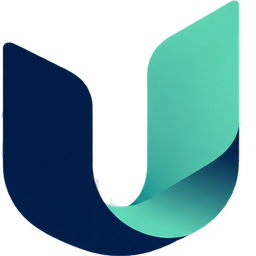

<div align="center">

<picture>
  <source media="(prefers-color-scheme: dark)" srcset="web/public/brand/logo-white.png">
  
</picture>

### 언어가 달라도 함께 어울리는 캠퍼스

**One campus, every language**

강원대학교 삼척캠퍼스 학생과 유학생을 위한 다국어 캠퍼스 앱

<br>

[](https://unimate-campus.vercel.app)
[](https://unimate-campus.vercel.app/signup)
[](https://unimate-campus.vercel.app/visit)


</div>

<br>

## Unimate는 이런 앱이에요

학교 공지, 학식 메뉴, 건물 이름, 학생 커뮤니티는 대부분 한국어로만 되어 있습니다. 한국어가 아직 서툰 유학생은 마감을 놓치거나, 강의실을 못 찾거나, 학생들 사이의 정보에서 멀어지기 쉽습니다.

Unimate는 이런 캠퍼스 생활을 **내 언어 하나로** 할 수 있게 만듭니다.

- 📢 **학교 소식을 내 언어로.** 학사·일반공지를 AI가 요약하고 번역합니다. 신청 마감은 할 일과 캘린더로 담습니다.
- 🍱 **오늘 학식을 내 언어로.** 학교 사이트에서 이번 주 식단을 바로 받아 메뉴 이름을 번역합니다.
- 🧭 **강의실까지 걸어서 안내.** 시간표의 다음 수업을 누르면 내 위치에서 강의실 건물까지 도보로 안내하고, 도착하면 몇 층 몇 호인지 알려 줍니다.
- 💬 **언어가 달라도 같은 게시판.** 글, 댓글, 쪽지가 읽는 사람의 언어로 번역됩니다. 한국 학생과 유학생이 같은 대화에 들어옵니다.
- 🛡️ **안전한 커뮤니티.** AI가 새 글과 신고된 글을 이용규칙에 따라 검수하고, 반복 위반에는 자동으로 제재합니다.

<br>

## 누구를 위한 앱인가요

| | 누구 | 이렇게 써요 |
|:---:|---|---|
| 🎓 | **유학생** (베트남·중국·우즈베키스탄 등) | 내 언어로 공지·학식·게시판을 보고, 강의실까지 길찾기 |
| 🙋 | **한국 학생** | 에브리타임처럼 시간표·게시판·강의평을 쓰면서 유학생과 자연스럽게 대화 |
| 🏛️ | **교직원·지역 주민·방문객** | 로그인 없이 방문객 모드에서 캠퍼스 지도·학식·공지 |

<br>

## 주요 기능

### 🏠 홈
- 지금 듣는 수업이나 다음 수업이 나옵니다. 강의실 건물과 층·호수, 작은 위성 지도, 바로 길찾기 버튼이 함께 있습니다.
- **자주 찾는 곳**(안내소·본부·도서관·학생회관·체육관)을 누르면 시간표가 없어도 바로 길찾기를 시작합니다.
- 학사공지, 오늘 학식, 실시간 인기 글, 즐겨찾는 게시판, 최근 강의평을 한 화면에서 봅니다.
- 한국 시간으로 자정이 지나면 화면이 스스로 새로고침해서, 늘 오늘 기준 정보가 나옵니다.

### 📢 공지와 🍱 학식
- 학교 사이트의 학사·일반공지를 가져와 AI가 요약하고 번역합니다.
- 공지에서 "신청 준비해 줘"를 누르면 마감을 할 일로 담습니다. 캘린더 파일(ICS)로도 받을 수 있습니다.
- 학식은 요청할 때마다 학교 사이트에서 이번 주 식단을 새로 받습니다.
- 번역은 미리 만들어 둔 저장본을 씁니다. 그래서 화면이 1초 안팎으로 열립니다.
  - 공지 번역은 매일 한국 시간 05:30에 새로 만듭니다.
  - 학식 메뉴 사전은 매주 월요일 06:00에 새로 만듭니다.

### 🧭 캠퍼스 지도와 길찾기
- 건물 27곳을 지도에 표시합니다. 건물을 누르면 안에 있는 시설과 운영시간, 전화번호가 나옵니다.
- 도보 경로 미리보기 → 안내 모드(다음 행동 배너, 지도 따라가기) → 도착하면 층·호수 안내 순서로 진행합니다.
- 경로를 40m 넘게 벗어나면 지금 위치에서 다시 찾습니다.
- 휴대폰이 향한 방향을 부채꼴로 보여 주고, 안내 중에는 "이쪽으로" 화살표를 띄웁니다.
- GPS 튐을 걸러 내고, 위치를 가까운 경로에 붙여 보여 줍니다.
- 위치 권한이 없으면 정문에서 출발하고, 데모 모드로 걸어 볼 수 있습니다.

### 🗓️ 시간표·학점·강의평
- 시간표를 여러 개 만들 수 있습니다. 수업 찾기로 담고, 직접 일정도 넣습니다. 시간이 겹치는 수업은 막습니다.
- 에브리타임 등에서 찍은 **시간표 캡처**를 올리면 AI가 읽어 자동으로 등록합니다.
- 학점계산기를 쓸 수 있고, 강의평가는 과목마다 한 번 쓸 수 있습니다.

### 💬 게시판·친구·쪽지
- 자유·유학생·비밀(익명)·새내기·정보·장터·동아리 게시판이 있고, 게시판을 직접 만들 수도 있습니다.
- HOT·BEST 글, 사진 첨부, 댓글·답글, 공감, 스크랩, 검색을 지원합니다.
- 학생 은어(꿀강·족보·공강·팀플·출첵 대출 등)도 뜻으로 번역합니다.
- 아이디나 QR로 친구를 맺고, 친구 시간표를 보고, 쪽지를 주고받습니다. 쪽지도 실시간으로 번역됩니다.

### 🛡️ 신고와 AI 자동 제재

| 위반 횟수 | 1번째 | 2번째 | 3번째 | 4번째부터 |
|:---:|:---:|:---:|:---:|:---:|
| 조치 | ⚠️ 경고 | ⚠️ 경고 | ⛔ 7일 제한 | ⛔ 30일 제한 |

- 남의 글과 댓글을 사유를 골라 신고할 수 있습니다. 같은 항목은 한 번만 신고됩니다.
- AI가 이용규칙에 어긋난다고 보면 그 글을 가립니다. 제한 기간에는 글·댓글·쪽지를 쓸 수 없습니다.
- AI 검수가 실패하면 제재하지 않습니다.

### 🌐 다섯 언어
화면 문구는 한국어·영어·베트남어·중국어·우즈베크어 다섯 언어로 모두 준비되어 있습니다. 가입할 때 국적을 고르면 그 나라 언어가 자동으로 골라지고, 원하면 언어를 따로 고를 수 있습니다.

<br>

## 직접 써 보기

<table>
<tr>
<td width="180" align="center"></td>
<td>

**휴대폰 카메라로 QR을 찍거나 [unimate-campus.vercel.app](https://unimate-campus.vercel.app)을 여세요.**

- 처음이라면 → [가입하기](https://unimate-campus.vercel.app/signup)
- 로그인 없이 둘러보기 → [방문객 모드](https://unimate-campus.vercel.app/visit)
- 로그인 화면에는 **민준**(한국어) · **王伟**(중국어) · **Linh**(베트남어) 데모 계정 버튼이 있습니다. 데모 계정은 국적과 언어를 바꿀 수 없습니다.

</td>
</tr>
</table>

<br>

## 브랜드 색

<p>


</p>

| 색 | 값 | 쓰는 곳 |
|---|---|---|
| **Navy** | `#011D48` | 로고 글자, 주요 버튼, 홈 수업 카드 |
| **Teal** | `#27A395` | 길찾기·안내 버튼, 강조 글자 |
| **Mint** | `#5BD2B4` | 홈의 길찾기 버튼, 지금 수업·실시간 표시 |
| **Mint Soft** | `#E6F8F3` | 안내 상자, 아이콘 배경 |
| **Star** | `#F5B400` | 강의평 별점 |

색 값은 [`web/src/app/globals.css`](web/src/app/globals.css)에 있습니다.

<br>

## 이렇게 만들었어요


| 영역 | 사용 기술 |
|---|---|
| 앱 | Next.js App Router, React, TypeScript, Tailwind CSS, zod |
| 저장소 | Supabase(Postgres, 실시간 채널, 번역 저장본). 키가 없으면 메모리 저장소와 시드 데이터로 동작 |
| AI | Claude: 번역, 공지 요약, 시간표 캡처 인식, 게시물 검수 |
| 지도 | 카카오맵 스카이뷰(없으면 Leaflet + 위성사진), TMAP 도보 경로(없으면 직선 경로) |
| 로그인 | 아이디·비밀번호(scrypt 해시), 서명한 세션 쿠키 |
| 배포 | Vercel(서울 리전), 정해진 시간에 번역 저장본을 새로 만드는 크론 |

외부 서비스 키가 하나도 없어도 앱 전체가 대역(가짜 AI, 직선 경로, Leaflet 지도, 메모리 저장소)으로 동작합니다. 그래서 바로 실행해서 시험해 볼 수 있습니다.

<br>

---

## 개발자 안내

<details>
<summary><b>실행하기</b></summary>

```sh
cd web
npm ci
npm run dev -- -p 3100
```

브라우저에서 `http://localhost:3100`을 엽니다.

</details>

<details>
<summary><b>명령</b> (<code>web/package.json</code>)</summary>

| 명령 | 하는 일 |
|---|---|
| `npm run dev` | 개발 서버 |
| `npm run build` / `npm start` | 프로덕션 빌드와 실행 |
| `npm run typecheck` | 라우트 타입 생성(`next typegen`) 뒤 `tsc` |
| `npm run lint` | ESLint |
| `npm test` | Vitest 단위 테스트(`web/tests`) |
| `npm run e2e` | Playwright 브라우저 테스트(`web/e2e`, 기본 주소 `http://localhost:3100`, `E2E_URL`로 변경) |
| `npm run seed:supabase` / `npm run reset:supabase` | Supabase 데모 데이터 넣기 / 데모 상태로 되돌리기(시드에 없는 행을 지운다) |
| `npm run rebuild:school -- notices [--retitle]` / `-- menu` | 크론을 기다리지 않고 공지·학식 번역 저장본 다시 만들기 |
| `npm run snapshots` | `tests/fixtures`의 HTML로 공지 저장본 JSON 다시 만들기 |

Vitest는 외부 키를 비운 채로 돌아서 항상 메모리 저장소와 가짜 AI를 씁니다. 브라우저 테스트를 실제 서비스 없이 돌리려면 외부 키를 비운 환경에서 빌드한 서버에 `E2E_URL`을 붙입니다. AI 키 없이 도는 시간표 캡처 테스트는 앱 아이콘 이미지를 올리고, 가짜 인식기가 예시 시간표를 돌려줍니다. 실제 AI로 돌릴 때는 `E2E_TIMETABLE_IMAGE`에 시간표 캡처 경로를 넣습니다.

</details>

<details>
<summary><b>환경 변수</b> (<code>web/.env.local</code>, 예시는 <code>web/.env.example</code>)</summary>

비어 있는 항목은 대역으로 동작합니다. 판단 기준은 `web/src/lib/env.ts`에 있습니다.

| 변수 | 쓰임 | 비었을 때 |
|---|---|---|
| `ANTHROPIC_API_KEY` | 번역, 공지 요약, 시간표 캡처 인식, 게시물 검수 | 데모 문장 사전과 키워드 검수기 |
| `SUPABASE_URL`, `SUPABASE_SERVICE_ROLE_KEY` | 서버 저장소 | 프로세스 메모리 저장소(시드 데이터) |
| `NEXT_PUBLIC_SUPABASE_URL`, `NEXT_PUBLIC_SUPABASE_ANON_KEY` | 브라우저 실시간 갱신 채널 | 서버의 SSE(`/api/live`) |
| `TMAP_APP_KEY` | 도보 경로 | 직선 경로 |
| `KAKAO_MAP_JS_KEY` | 카카오맵 | Leaflet 지도 |
| `SESSION_SECRET` | 세션 쿠키 서명 | 개발용 기본값(프로덕션에서는 필수) |
| `STATS_KEY` | `/stats?key=…` 통계 화면과 `/api/stats/csv` 열쇠 | 통계 화면이 404 |
| `DEMO_LOGIN` | `1`이면 Supabase 저장소를 쓸 때도 로그인 화면에 데모 계정 버튼 표시 | 메모리 저장소일 때만 표시 |

</details>

<details>
<summary><b>Supabase</b></summary>

`web/supabase/schema.sql`은 테이블, 인덱스, 원자적 처리 함수(공감·스크랩 토글, 시간표 교체, 위반 처리)를 만듭니다. 여러 번 실행해도 됩니다. 신고·검수·제재와 이용 통계 부분은 파일 끝 블록에 모여 있습니다. 공지 마감 할 일 표는 `web/supabase/notice-tasks.sql`로 만듭니다.

</details>

<details>
<summary><b>학교 데이터</b></summary>

- 식단은 요청마다 학교 사이트에서 한국 시간 기준 이번 주(토요일에는 다음 주)를 받아 옵니다. 실패하면 한 번 다시 시도하고, 그래도 실패하면 오류 안내와 다시 시도 버튼을 보여 줍니다.
- 공지는 한국 날짜별로 10분 동안 캐시합니다. 학교 사이트에 닿지 않으면 저장본(`web/src/lib/school/snapshot/notices.json`)을 출처 표시와 함께 보여 줍니다.
- 공지·학식 번역은 크론(`web/vercel.json`)이 미리 만들어 Supabase Storage에 둡니다. 화면은 저장본을 읽고, 새로 생긴 메뉴 이름은 원문으로 보였다가 1시간 안에 번역이 채워집니다.
- 홈·식단·공지 화면은 한국 시간 자정이 지나거나 탭으로 돌아왔을 때 날짜가 바뀌었으면 스스로 새로고침합니다. 보이는 동안에는 30분마다 갱신합니다.

</details>

<details>
<summary><b>이용 통계</b></summary>

- 브라우저 수집기(`web/src/components/Tracker.tsx`)가 화면 보기, 언어 선택, 공지 열기·읽은 시간, 도우미 버튼, 화면 오류를 `/api/events`로 보냅니다.
  - 방문객은 무작위 세션 id만 남습니다.
  - 로그인한 사용자는 서버가 세션으로 확인한 계정과 함께 기록됩니다.
  - IP는 저장하지 않습니다.
- 서버는 공지·학식·AI·길찾기 작업의 걸린 시간과 성공 여부를 기록합니다(`web/src/lib/metrics.ts`).
- `/stats?key=…`에서 다음을 봅니다. 세션, 퍼널, 걸린 시간(중앙값·p75·p95), 성공률, 오류, 사용자별 활동, 가입자(아이디·닉네임·국적·언어).
- `/api/stats/csv?type=events|users|signups&key=…`로 CSV를 받습니다. `from`·`to`(한국 날짜)로 기간을 고릅니다.
- 기록은 `schema.sql`의 `events` 표에 쌓입니다. Vercel 운영 배포(`VERCEL_ENV=production`)에서만 남습니다. 로컬 개발 서버·테스트·스크립트는 같은 DB를 써도 기록하지 않습니다. 통계 화면은 어디서나 그대로 읽습니다.

</details>

<details>
<summary><b>배포</b></summary>

`web/.vercel/project.json`이 Vercel 프로젝트 `unimate`에 연결되어 있습니다. `web`에서 `npx vercel deploy --prod`로 배포합니다. 프로젝트 도메인은 `unimate-campus.vercel.app`이고, 함수 지역은 서울(`icn1`)입니다.

</details>

<details>
<summary><b>폴더 구조</b></summary>

| 폴더 | 내용 |
|---|---|
| `web/src/app` | 페이지와 API. 로그인 뒤 화면은 `(tabs)`, 방문객 화면은 `visit`, 서버 액션은 `*-actions.ts` |
| `web/src/lib` | 저장소(`store`), 인증(`auth`), 학교 데이터(`school`), 지도(`map`), 시간표(`timetable`), AI(`ai`), 검수·제재(`moderation.ts`) |
| `web/tests`, `web/e2e` | 단위 테스트, 브라우저 테스트 |
| `deliverables/measure` | 공지 읽기 측정 도구([설명](deliverables/measure/README.md)) |
| `deliverables/presentation` | 발표 자료용 화면 녹화·QR 스크립트 |

</details>

<br>

<div align="center">

<br>
<sub>강원대학교 삼척캠퍼스 해커톤 팀이 만들었습니다</sub>
</div>
